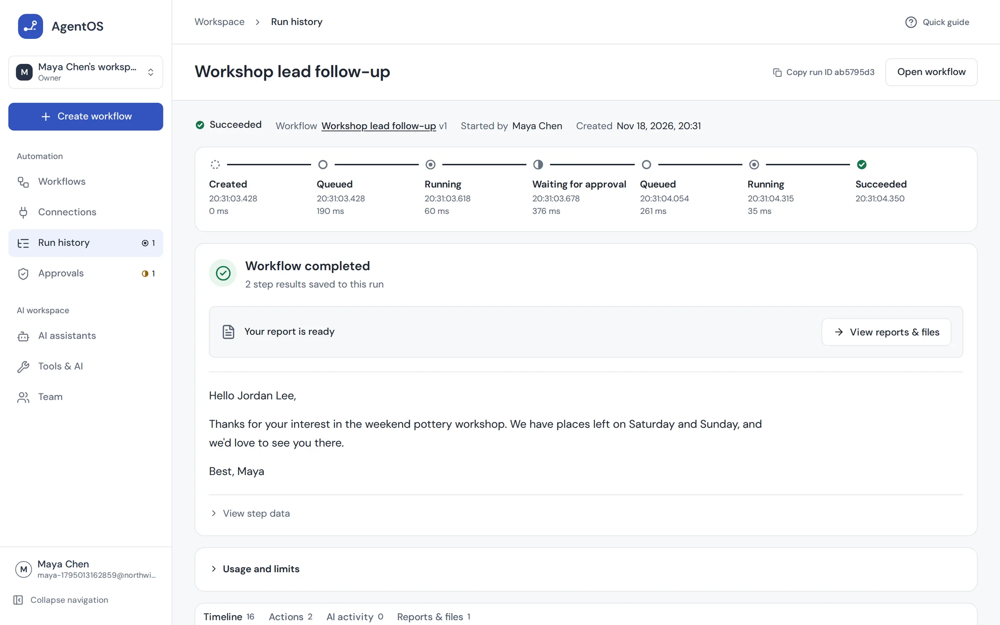
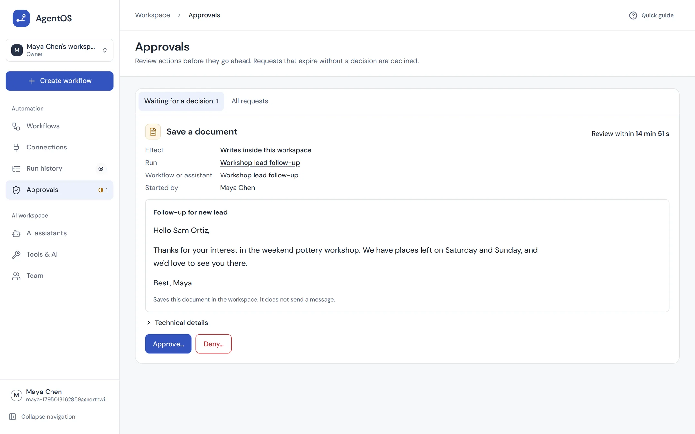

<p align="center">
  
</p>

<h1 align="center">AgentOS</h1>

<p align="center"><strong>Build workflows that handle the work you repeat.</strong></p>

<p align="center">
  Turn spreadsheet rows, customer feedback, and meeting notes into reports, issues, and updates.<br />
  Connect your apps, add AI where it helps, and track every run.
</p>

<p align="center">
  <a href="https://agentos-home.vercel.app"><strong>Explore AgentOS</strong></a>
  &nbsp;·&nbsp;
  <a href="https://agentos-home.vercel.app/#try"><strong>Try the workflow playground</strong></a>
  &nbsp;·&nbsp;
  <a href="https://agentos-workspace.vercel.app">Open the workspace</a>
</p>

## Inside AgentOS

<picture>
  <source media="(prefers-color-scheme: dark)" srcset="https://raw.githubusercontent.com/shresthashim/AgentOS/main/public/images/tour/build-dark.webp" />
  
</picture>

**Build visually.** Arrange steps on the canvas, map outputs into the next action, and test with sample data before publishing.

<table>
  <thead>
    <tr>
      <th scope="col" width="50%">Follow each run</th>
      <th scope="col" width="50%">Review outgoing actions</th>
    </tr>
  </thead>
  <tbody>
    <tr>
      <td valign="top">
        <picture>
          <source media="(prefers-color-scheme: dark)" srcset="https://raw.githubusercontent.com/shresthashim/AgentOS/main/public/images/tour/review-dark.webp" />
          
        </picture><br />
        See which steps ran, where the workflow paused, and what it produced.
      </td>
      <td valign="top">
        <picture>
          <source media="(prefers-color-scheme: dark)" srcset="https://raw.githubusercontent.com/shresthashim/AgentOS/main/public/images/tour/approve-dark.webp" />
          
        </picture><br />
        Inspect the exact email, rows, or other details before approving a write.
      </td>
    </tr>
  </tbody>
</table>

## What you can automate

| Use case | Workflow |
| --- | --- |
| **Weekly sales reporting** | Read Google Sheets, calculate totals, draft a summary, and send the report through Gmail. |
| **Lead follow-up** | Start from a new enquiry, record the lead in a spreadsheet, and draft a personalized reply. |
| **Meeting notes** | Summarize call notes, create a Notion page, and share the result in Slack. |
| **Customer feedback** | Summarize a request, open a GitHub issue, and add a follow-up task in Todoist. |

Workflows can start on a schedule, through an authenticated webhook, or from supported Google Sheets changes. Use standard steps for calculations and filters, and add AI for tasks such as drafting or summarizing. Test before publishing and use run history to inspect individual steps. Actions that require approval pause for review before they run.

## Connected apps

<p>
  &nbsp;&nbsp;
  &nbsp;&nbsp;
  &nbsp;&nbsp;
  &nbsp;&nbsp;
  &nbsp;&nbsp;
  &nbsp;&nbsp;
  
</p>

Gmail · Google Sheets · Google Calendar · Slack · Notion · GitHub · Todoist

## Explore the site

- [**Workflow playground**](https://agentos-home.vercel.app/#try) — choose a trigger and actions, then watch a simulated run.
- [**Product tour**](https://agentos-home.vercel.app/#tour) — see the workflow editor, approval screen, and run timeline.
- [**Workflow templates**](https://agentos-home.vercel.app/#templates) — browse examples for support, sales, reporting, and operations.

This repository contains the landing site and interactive demos. The workflow editor, API, worker, and deployment instructions live in the [AgentOS platform repository](https://github.com/shresthashim/agentos-platform) for contributors with access.

## Run locally

Requires **Node.js 20.9+** and npm. The landing site runs locally without API keys or a database.

```bash
git clone https://github.com/shresthashim/AgentOS.git
cd AgentOS
npm ci
npm run dev -- --port 3400
```

Open [localhost:3400](http://localhost:3400). Workspace links default to `https://agentos-workspace.vercel.app`. To point them somewhere else, copy [`.env.example`](.env.example) to `.env.local` and set `NEXT_PUBLIC_APP_URL` before starting the dev server or building the site.

```bash
npm run lint
npm run build
npm run start -- --port 3400
```

## Site architecture

**Next.js App Router · React · Tailwind CSS · React Three Fiber · Motion**

| Path | Responsibility |
| --- | --- |
| [`src/app/`](src/app) | Page composition, metadata, styles, and self-hosted fonts |
| [`src/components/hero/`](src/components/hero) | Interactive 3D workflow preview and its static fallback |
| [`src/components/sections/`](src/components/sections) | Playground, product tour, templates, and other landing sections |
| [`src/lib/site.ts`](src/lib/site.ts) | Workspace URL, integration details, and example workflows |
| [`public/`](public) | Integration icons and product tour images |

The homepage is statically prerendered. The 3D preview loads in the browser and has a static fallback for devices without WebGL. Workflow tabs support arrow-key navigation, and the site respects system light, dark, and reduced-motion preferences.
